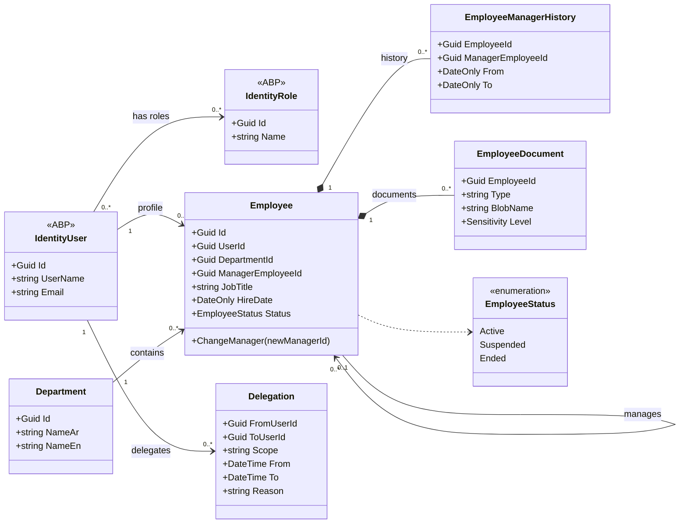
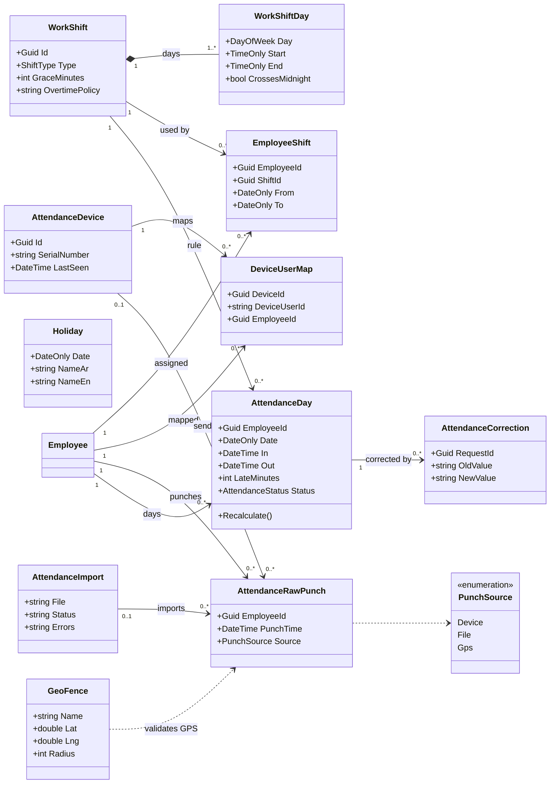
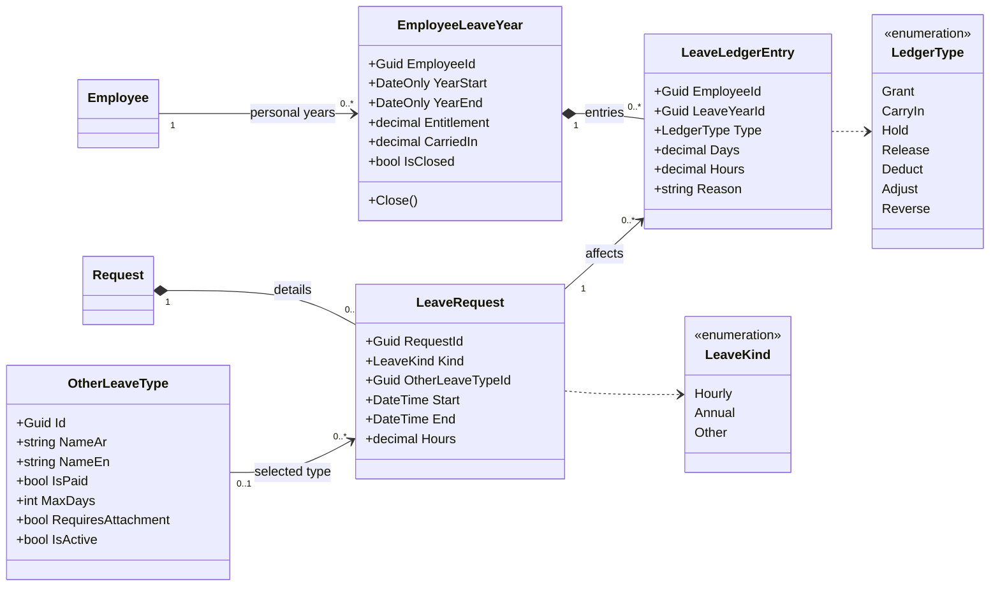
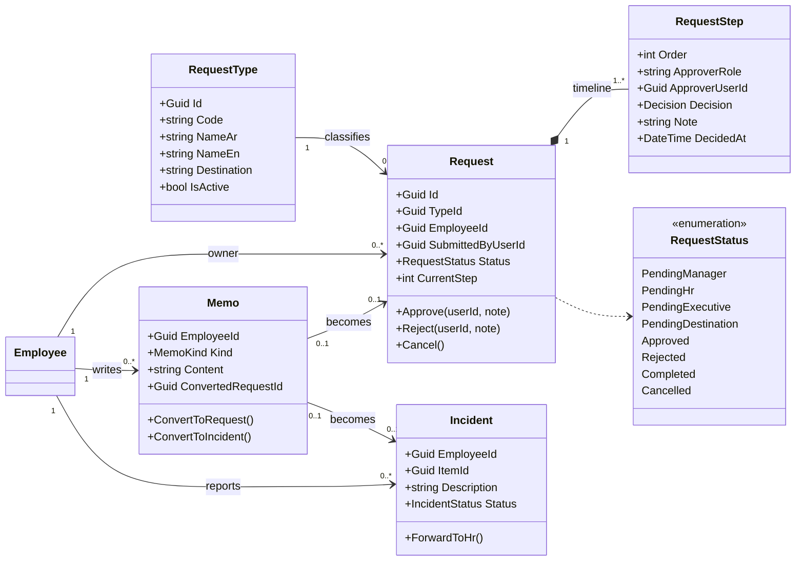
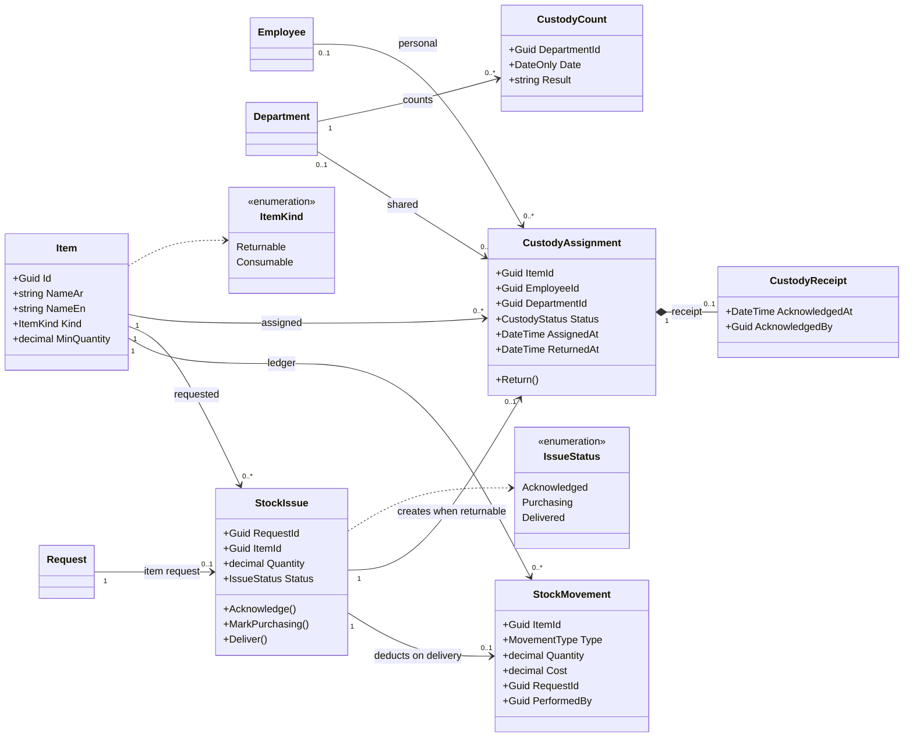
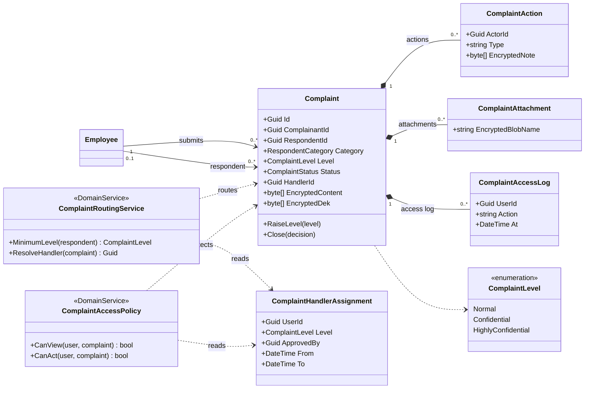
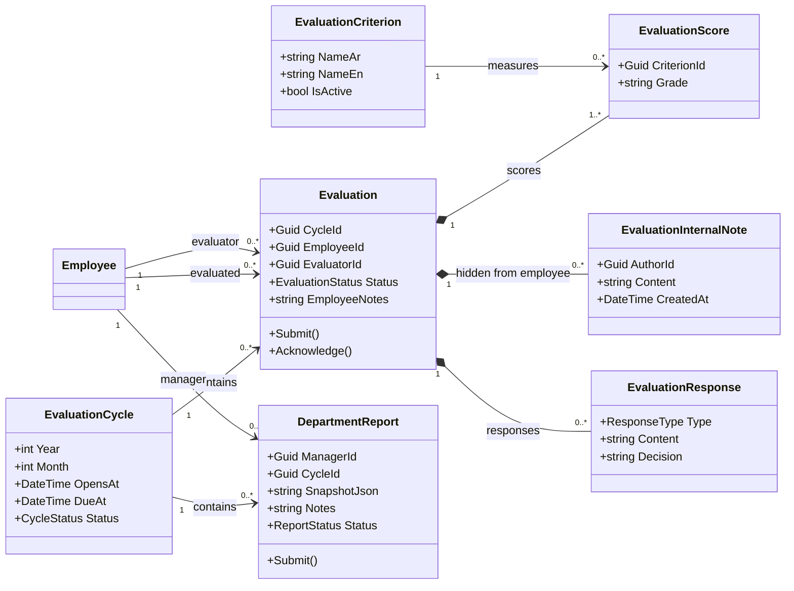
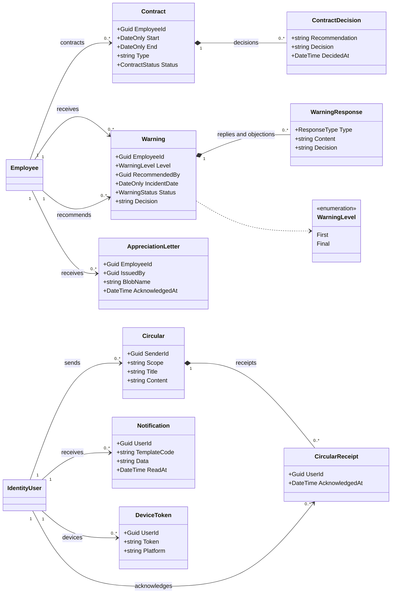
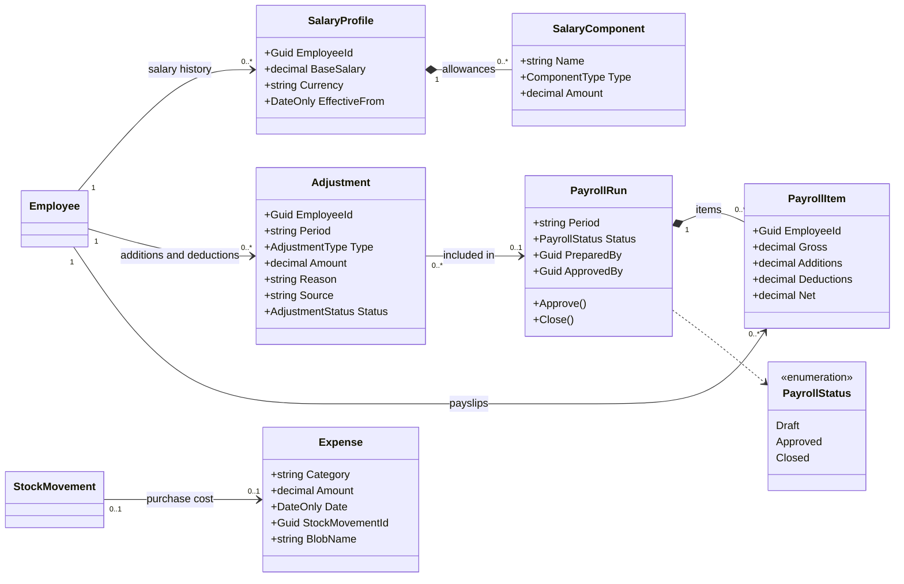
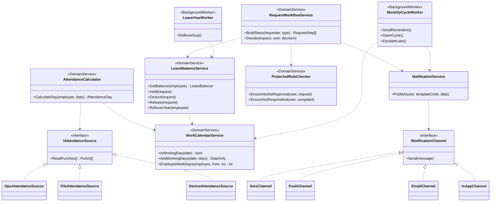

# النظام الإلكتروني للإدارة والموارد البشرية

**وثيقة المتطلبات والتصميم – الإصدار 1.0**
**التاريخ:** 4 نوفمبر 2026
**الحالة:** جاهزة للمراجعة قبل بدء التنفيذ

**مراجع الوثيقة بترتيب الأولوية:**
1. قرارات مالك المشروع في جلسات التحليل.
2. ملف `تصور_النظام_الإلكتروني_للإدارة_والموارد_البشرية.pdf`.
3. الافتراضات والاقتراحات المذكورة صراحة في هذه الوثيقة.

**الوسوم:** **[قرار]** من مالك المشروع، **[ملف]** من الوثيقة الأصلية، **[افتراض]** مقترح معتمد لأن المالك لم يعترض عليه، **[اقتراح]** تصميم تقني.

---

## 1. التقنيات المعتمدة

| الطبقة | التقنية المعتمدة | الوسم |
|---|---|---|
| الباك إند | ASP.NET Core Web API على **ABP Framework** | [قرار] |
| الفرونت إند | **Flutter**: Android وiOS، وFlutter Web للكمبيوتر | [قرار] |
| الإصدار | ABP 10.x على .NET 10 LTS (الدعم حتى 14 نوفمبر 2028) | [اقتراح] |
| قاعدة البيانات | PostgreSQL مع EF Core | [اقتراح] |
| الاستضافة | سحابة | [قرار] |
| الدخول | OpenIddict: Authorization Code + PKCE | [اقتراح] |
| المهام الخلفية | ABP Background Jobs/Workers مع Hangfire | [اقتراح] |
| الملفات | تخزين سحابي متوافق مع S3 عبر ABP BLOB Storing | [اقتراح] |
| الإشعارات | FCM وAPNs والبريد والإشعار الداخلي | [ملف] |
| اللغات | العربية (افتراضية) والإنجليزية | [قرار] |

**المقصود بالكمبيوتر:** Flutter Web يعمل من المتصفح دون تثبيت **[افتراض]**. ويمكن إضافة تطبيق Windows بـFlutter لاحقًا إذا طُلب.

### 1.1 القائمة الكاملة للتقنيات

ASP.NET Core وABP وFlutter والاستضافة السحابية **[قرار]**، وبقية القائمة **[اقتراح]**. الحالة تعني: **أساسي** من البداية، **عند الحاجة** حسب التشغيل، **لاحقًا** مع ميزة مؤجلة. تُثبَّت الإصدارات عند إنشاء المشروع، ويُراجع ترخيص كل مكتبة خارجية قبل اعتمادها.

#### الباك إند

| التقنية | الاستخدام | الحالة |
|---|---|---|
| C# و.NET 10 LTS | لغة ومنصة التطوير | أساسي |
| ASP.NET Core Web API | بناء الـAPI | أساسي |
| ABP Framework 10.x | هيكل النظام والوحدات والمزايا الجاهزة | أساسي |
| ABP Identity وPermission Management | المستخدمون والأدوار والصلاحيات | أساسي |
| OpenIddict | إصدار رموز الدخول (OAuth 2.0 وOpenID Connect) | أساسي |
| EF Core وNpgsql | الوصول إلى PostgreSQL والترحيلات | أساسي |
| FluentValidation | التحقق من المدخلات | أساسي |
| Mapperly | التحويل بين الكيانات وDTOs، حسب قالب ABP المختار | أساسي |
| Hangfire مع Hangfire.PostgreSql | التذكير والتصعيد وترحيل الأرصدة والاستيراد | أساسي |
| ABP Event Bus وOutbox | أحداث موثوقة وعدم ضياع الإشعارات | أساسي |
| SignalR | تحديث الإشعارات الداخلية لحظيًا | أساسي |
| MailKit | إرسال البريد | أساسي |
| Firebase Admin SDK | إرسال إشعارات الهاتف والويب | أساسي |
| QuestPDF | تقارير PDF وقسائم الرواتب | أساسي |
| ClosedXML | تصدير واستيراد Excel | أساسي |
| Swagger / OpenAPI | توثيق الـAPI وتوليد عميل Flutter | أساسي |
| Serilog | السجلات، دون بيانات حساسة | أساسي |
| OpenTelemetry | تتبع الأداء والأخطاء | عند الحاجة |
| Redis | ذاكرة مؤقتة موزعة عند تشغيل أكثر من نسخة | عند الحاجة |
| ClamAV | فحص المرفقات من الفيروسات | أساسي |

#### الفرونت إند

| التقنية | الاستخدام | الحالة |
|---|---|---|
| Dart وFlutter | تطبيق Android وiOS والويب | أساسي |
| Riverpod | إدارة الحالة | أساسي |
| go_router | التنقل والروابط المباشرة | أساسي |
| Dio | الاتصال بالـAPI | أساسي |
| OpenAPI Generator | توليد عميل الـAPI من Swagger | أساسي |
| freezed وjson_serializable | نماذج البيانات | أساسي |
| flutter_localizations وintl وARB | اللغتان والتواريخ والأرقام | أساسي |
| flutter_appauth | الدخول على الهاتف بـCode + PKCE | أساسي |
| flutter_secure_storage | حفظ الرموز في Keychain وKeystore | أساسي |
| firebase_core وfirebase_messaging | استقبال الإشعارات | أساسي |
| signalr_netcore | تحديث الإشعارات الداخلية | أساسي |
| file_picker | رفع الوثائق والمرفقات | أساسي |
| data_table_2 | الجداول الكبيرة على الكمبيوتر | أساسي |
| fl_chart | رسوم التقارير | أساسي |
| printing وpdfx | عرض ملفات PDF وطباعتها | أساسي |
| geolocator وflutter_map | حضور GPS ومناطق العمل | لاحقًا |

#### البيانات والملفات والأمان

| التقنية | الاستخدام | الحالة |
|---|---|---|
| PostgreSQL | قاعدة البيانات، مع JSONB وRow-Level Security | أساسي |
| تخزين متوافق مع S3 عبر ABP BLOB Storing | الوثائق والمرفقات | أساسي |
| خزنة مفاتيح سحابية (KMS / Key Vault) | مفاتيح تشفير الشكاوى والأسرار | أساسي |
| AES-256-GCM | تشفير محتوى الشكاوى بطريقة المغلف | أساسي |
| TLS 1.2 فأعلى | تشفير الاتصال | أساسي |
| TOTP | التحقق بخطوتين | أساسي |
| OWASP ASVS وMASVS | مرجع المراجعة الأمنية | أساسي |
| OWASP ZAP | فحص أمني آلي | أساسي |

#### التشغيل والجودة

| التقنية | الاستخدام | الحالة |
|---|---|---|
| Docker | تغليف الـAPI والعمليات الخلفية | أساسي |
| Nginx أو موزع السحابة | عكس الطلبات وTLS | أساسي |
| Git وGitHub Actions (أو ما يماثله) | إدارة الكود والبناء والنشر | أساسي |
| xUnit وShouldly وNSubstitute | اختبارات الباك إند | أساسي |
| Testcontainers | اختبارات تكامل على PostgreSQL حقيقي | أساسي |
| flutter_test وintegration_test وmocktail | اختبارات Flutter | أساسي |
| Firebase Crashlytics أو Sentry | رصد أعطال التطبيق | عند الحاجة |
| Figma | تصميم الشاشات | أساسي |
| Mermaid | مخططات هذه الوثيقة | أساسي |

#### التكاملات والتوسعات

| التقنية | الاستخدام | الحالة |
|---|---|---|
| وسيط بصمة محلي (.NET Worker) أو دفع مباشر من الجهاز | قراءة بيانات البصمة، حسب طراز الجهاز | أساسي |
| FCM وAPNs | قنوات إشعارات الهاتف | أساسي |
| خدمة SMS من مزود محلي | الرسائل النصية | لاحقًا |
| خدمة نماذج ذكاء اصطناعي مع بحث في مستندات السياسات | المساعد الذكي | لاحقًا |

مزود السحابة لم يُحدَّد بعد، ويُختار بعد حسم مكان استضافة البيانات.

---

## 2. نطاق النظام

### داخل النطاق

- الحسابات والصلاحيات، والموظفون، وربط كل موظف بمدير قسم.
- الدوام والورديات والحضور من البصمة، مع جاهزية لإضافة GPS.
- الإجازات والطلبات والمطالعات وبلاغات الأعطال.
- الشكاوى بثلاثة مستويات، وسجل تدقيق.
- التقارير والتقييم والتعاميم.
- المخزن والعهد والعقود والإنذارات وكتب الشكر.
- وحدة محاسبة مبسطة.

### خارج النطاق حاليًا

- دفتر أستاذ وقيود محاسبية كاملة، والربط البنكي، والضرائب والضمان التلقائي.
- التوظيف، والتدريب.
- شاشات إدارة عدة شركات. التصميم جاهز لها، لكنها لا تُبنى الآن.

### قواعد عامة **[قرار]**

- النظام لشركة واحدة الآن، وقد يخدم عدة شركات لاحقًا.
- الحجم المتوقع حوالي 200 شخص.
- لا توجد بيانات قديمة للترحيل.
- القواعد القانونية والإجازات إعدادات تحددها الشركة، ولا تُثبَّت في الكود لبلد أو إقليم.

---

## 3. الأدوار

يمكن أن يملك المستخدم أكثر من دور، وتكون صلاحياته مجموع أدواره **[قرار]**.

| الدور | العدد الحالي | الصلاحيات الأساسية |
|---|---|---|
| الموظف | متعدد | ملفه، حضوره، إجازاته، طلباته، مطالعاته، بلاغاته، شكاواه، عهدته، تعاميمه |
| مدير القسم | متعدد | موظفوه المرتبطون به، الموافقة الأولى، التعاميم، التقييم، تقارير فريقه، جرد عهدة القسم؛ **دون البيانات المالية والشكاوى السرية** |
| مدير الإدارة والموارد البشرية | 1 | الملفات، إنشاء الحسابات، الأرصدة، الاعتماد النهائي، العقود، الإنذارات، الشكاوى ضمن نطاقه |
| المدير التنفيذي (وهو مالك الشركة **[قرار]**) | 1 | الشكاوى السرية جدًا، كتب الشكر، الموافقات المحددة له |
| المراجع (المتابع) | 1 | تقارير المراجعة بأعداد دون أسماء أو تفاصيل الشكاوى، وتوصية إنذار على مدير قسم |
| المحاسب | 1 | الوحدة المالية المبسطة |
| مسؤول المخزن | حسب التعيين | الأصناف والحركات، واسم الموظف وقسمه فقط، والعهد |
| مسؤول النظام | حسب التعيين | الإعدادات والصلاحيات والتشغيل، والمدير الأعلى لمديري الأقسام؛ **دون محتوى الشكاوى السرية** |

**مدير القسم = رئيس القسم** **[قرار]**، وتستخدم الواجهة تسمية واحدة هي «مدير القسم».

### ربط الموظف بالمدير **[قرار]**

- عند إضافة موظف تُحدد بياناته ونوع دوامه ومدير قسمه وأدواره.
- عند تعيين مدير قسم يمكن اختيار موظفيه دفعة واحدة.
- الشركة قد تضم عدة مديرين، ولكل مدير مجموعته.
- مسارات الطلبات والتقارير والتعاميم تعتمد على هذا الربط.
- كل تغيير في الربط يُحفظ بتاريخه.
- عند تغيير المدير تنتقل الطلبات المعلقة إلى المدير الجديد **[افتراض]**.
- لكل موظف مدير مرتبط، باستثناء المدير التنفيذي **[افتراض]**.

### قواعد لا يمكن تجاوزها من الإعدادات **[اقتراح]**

1. لا يعتمد أحد طلبه الشخصي.
2. لا يرى المشتكى عليه الشكوى المقدمة ضده، مهما كانت أدواره.
3. مسؤول النظام لا يرى محتوى الشكاوى السرية حتى لو أضاف لنفسه دورًا آخر.
4. تعيين جهة معالجة للشكاوى يحتاج موافقة المدير التنفيذي، ويُسجل في سجل التدقيق.
5. الشكاوى لا تُحذف.

### الحسابات وكلمات السر

- مدير الموارد البشرية ينشئ الملف والحساب، ويسلم الموظف اسم المستخدم وكلمة السر **[قرار]**.
- كلمة السر الأولى مؤقتة، وتغييرها **إجباري عند أول دخول** **[اقتراح]**.
- لا يستطيع أي مستخدم رؤية كلمة السر بعد إنشائها، وإعادة تعيينها تُسجل ويُشعر بها الموظف **[اقتراح]**.
- بعد الدخول يرى الموظف حسابه وخياراته حسب صلاحياته **[قرار]**.
- التحقق بخطوتين إلزامي لمدير الموارد والمدير التنفيذي والمحاسب ومسؤول النظام **[اقتراح]**.

---

## 4. مصفوفة الموافقات

| الطلب من | إجازة أو تصحيح بصمة | طلب من المخزن | طلب من المحاسب |
|---|---|---|---|
| الموظف | مدير القسم ← الموارد البشرية | مدير القسم ← الموارد البشرية ← المخزن | مدير القسم ← الموارد البشرية ← المحاسب [افتراض] |
| مدير القسم | مسؤول النظام ← الموارد البشرية | مسؤول النظام ← الموارد البشرية ← المخزن | مسؤول النظام ← الموارد البشرية ← المحاسب |
| مدير الموارد البشرية | المدير التنفيذي [افتراض] | المخزن مباشرة [قرار] | المدير التنفيذي ← المحاسب [قرار] |
| المدير التنفيذي | لا يقدم إجازة [قرار] | المخزن مباشرة [قرار] | المحاسب مباشرة [قرار] |
| مسؤول النظام | المدير التنفيذي [افتراض] | المدير التنفيذي ← المخزن [افتراض] | المدير التنفيذي ← المحاسب [افتراض] |

- لا توجد مهلة موافقة، ويبقى الطلب معلقًا حتى يوافق المسؤول أو يرفض **[قرار]**.
- يصل تذكير دوري دون إجراء تلقائي **[اقتراح]**.
- يوجد مفوض بديل اختياري لكل معتمد، والتفويض مسجل بمدة وسبب **[ملف]**.
- الرفض في أي خطوة ينهي الطلب ويُظهر السبب للموظف **[افتراض]**.
- مدير القسم يرفع طلبًا نيابة عن موظف مع تسجيل مقدمه الفعلي وإشعار الموظف، وتُعد موافقته الأولى تمت، ثم ينتقل الطلب إلى الموارد البشرية **[ملف + افتراض]**.
- الحالات التي يراها الموظف: بانتظار مدير القسم، بانتظار الموارد البشرية، موافق عليه، مرفوض، مكتمل **[ملف]**.

---

## 5. المتطلبات الوظيفية

### 5.1 ملف الموظف

- البيانات والقسم والمسمى وتاريخ المباشرة والعقد والوثائق **[ملف]**.
- سجلات: الحضور، الإجازات، الطلبات، المطالعات، التقييم، كتب الشكر، الإنذارات **[ملف]**.
- الشكاوى **لا تظهر** ضمن عرض الملف لمدير القسم **[اقتراح]**.
- البيانات المالية لا تظهر لمدير القسم ولا لمسؤول المخزن **[ملف]**.
- مدير القسم يملك ملف موظف كاملًا، مع سجل مهامه الإدارية **[ملف]**.

### 5.2 الدوام والورديات

- يضيف مسؤول الموارد أو النظام قوالب دوام: ثابت، متناوب، ليلي يمتد بعد منتصف الليل **[قرار + اقتراح]**.
- كل قالب يحدد الأيام والساعات والسماح بالتأخير وطريقة احتساب العمل الإضافي **[افتراض]**.
- يختار مدير الموارد البشرية نوع الدوام عند إضافة الموظف، ويمكن تغييره بتاريخ بداية **[قرار]**.
- العطل الرسمية والأسبوعية تُدار من الإعدادات **[ملف]**.
- **تقويم الشركة** يحدد المواعيد الإدارية مثل «آخر يوم دوام» ومهل التقييم، بينما تحدد وردية الموظف حضوره **[اقتراح]**.

### 5.3 الحضور

- يحدد مسؤول النظام طريقة الحضور: بصمة، أو GPS عند إضافته، أو الاثنين **[قرار]**.
- تُحفظ العملية الخام مع مصدرها، ولا تُعدَّل **[اقتراح]**.
- الحساب اليومي يخرج التأخر والغياب وساعات الدوام **[ملف]**.
- استيراد الملفات يبقى متاحًا كخطة احتياطية **[اقتراح]**.
- لا تُخزن قوالب البصمات الحيوية، وإنما أوقات الحضور فقط **[اقتراح]**.

#### تصحيح البصمة **[قرار]**

1. يختار الموظف «طلب تصحيح بصمة».
2. يحدد التاريخ ونوع المشكلة: دخول أو خروج.
3. يكتب الوقت الصحيح والسبب.
4. يوافق مدير القسم.
5. تعتمد الموارد البشرية نهائيًا.
6. يُصحح الحضور مع الاحتفاظ بالأصل وسجل التعديل.

بعد إغلاق الشهر يُصحح السجل، ويظهر الأثر المالي تسوية في الشهر التالي **[افتراض]**.

#### حضور GPS (لاحقًا) **[قرار + اقتراح]**

- مناطق عمل على الخريطة بنصف قطر محدد.
- يُؤخذ الموقع عند تسجيل الحضور فقط، دون تتبع مستمر.
- كشف المواقع المزيفة قدر الإمكان، مع تسجيل ما يُشك فيه.

### 5.4 الإجازات

عند تقديم الطلب يختار الموظف أحد ثلاثة أنواع **[قرار]**:

| النوع | الحقول | الخصم |
|---|---|---|
| زمنية | التاريخ، من ساعة، إلى ساعة | رصيد الزمنيات، والزيادة من الرصيد السنوي |
| من الرصيد | من تاريخ، إلى تاريخ | الرصيد السنوي |
| أخرى | النوع والتواريخ والمرفق حسب النوع | حسب إعدادات النوع |

#### الأنواع الأخرى

- يضيف مسؤول النظام أنواعًا مثل المرضية والولادة والحداد، وتظهر مباشرة للموظفين **[قرار]**.
- إعدادات كل نوع: الاسم بالعربية والإنجليزية، مدفوع أم لا، الحد الأقصى، الحاجة إلى مرفق، الفئة المستحقة، وتفعيله **[اقتراح]**.
- لا تخصم من السنوي افتراضيًا **[افتراض]**.

#### الرصيد السنوي **[قرار]**

- لكل موظف سنة خاصة تبدأ من **يوم مباشرته**، ولا علاقة لها بالسنة التقويمية.
- مدير الموارد البشرية يحدد عدد الأيام يدويًا، مثل 21 أو 24.
- مدير الموارد البشرية يستطيع إضافة إجازة أو تعديل رصيد موظف.
- عند انتهاء السنة يُرحَّل المتبقي باسم **«الإجازات المضافة من السنة الماضية»**.

**مثال:** موظف باشر في 15/3/2026 برصيد 24 يومًا واستخدم 18 يومًا. في 15/3/2027 يُرحَّل له 6 أيام، وإذا حُددت سنته الجديدة بـ21 يومًا يصبح رصيده 27 يومًا.

#### قواعد الحساب **[افتراض]**

| القاعدة | المعتمد |
|---|---|
| ترتيب الخصم | الأيام المضافة أولًا، ثم رصيد السنة الحالية |
| الأيام المحسوبة | أيام دوام الموظف فقط، دون الإجازات الأسبوعية والرسمية |
| وقت الخصم | حجز عند التقديم، وخصم عند الاعتماد النهائي، وفك الحجز عند الرفض |
| تجاوز الرصيد | غير مسموح، إلا إذا أضاف مدير الموارد البشرية أيامًا |
| الإجازة الممتدة بين سنتين | تُقسم الأيام على السنتين تلقائيًا |
| تغيير عدد الأيام | يبدأ من سنة الموظف القادمة، والتعديل الحالي يدوي مع السبب |
| الترحيل | كل المتبقي، دون حد أقصى |
| المباشرة في 29 فبراير | تبدأ السنة في 28 فبراير إذا لم تكن السنة كبيسة |
| الزمنيات | إعدادات: الساعات المسموحة في الشهر، وكم ساعة تساوي يومًا |

### 5.5 الطلبات

- الأنواع: إجازة، تصحيح بصمة، قطعة من المخزن، طلب من المحاسب، احتياج إداري **[ملف + قرار]**.
- يدير مسؤول النظام أنواع الطلبات من الإعدادات **[ملف]**.
- كل طلب له خط زمني يوضح من قرر ومتى ولماذا **[اقتراح]**.
- صندوق موحد «بانتظار إجرائي» لكل معتمد **[ملف]**.

### 5.6 المطالعات والبلاغات

- المطالعة تصل **أولًا إلى مدير القسم**، ثم الموارد البشرية **[قرار]**.
- مطالعة الإجازة تتحول إلى طلب إجازة، ومطالعة المشكلة تتحول إلى بلاغ **[ملف]**.
- بلاغ العطل يسير: مدير القسم ← الموارد البشرية **[قرار]**.
- يرى الموظف أين وصل طلبه، وهل تمت الموافقة عليه **[قرار]**.

### 5.7 المخزن والعهد

**مسار طلب القطعة [قرار + ملف]:**

الموظف ← مدير القسم ← الموارد البشرية ← مسؤول المخزن يؤشر «اطلعت» ← شراء القطعة إن لم تتوفر ← التسليم ← تسجيلها عهدة.

- تُخصم الكمية عند **التسليم الفعلي فقط** **[ملف]**.
- إذا لم يتوفر الصنف، يُسجل «بانتظار الشراء» ولا يُرفض الطلب تلقائيًا **[قرار]**.
- تصل تكلفة الشراء إلى مصروفات المحاسب **[قرار]**.
- يسجل مسؤول المخزن دخول المواد **[افتراض]**.
- الأصناف نوعان: تُسترد وتصبح عهدة، ومستهلكة لا تصبح عهدة **[اقتراح]**.
- يختار مسؤول المخزن من قائمة موظفين تظهر فيها **الاسم والقسم فقط**، ويضيف عهدة مباشرة **[قرار]**.
- العهدة شخصية باسم الموظف، أو مشتركة باسم القسم **[ملف]**.
- مدير القسم يتابع جرد العهدة المشتركة، ولا يتحمل مسؤوليتها الشخصية إلا بمحضر باسمه **[ملف]**.
- يؤكد الموظف الاستلام داخل التطبيق، مع تسجيل الوقت والمستخدم **[افتراض]**.

### 5.8 الشكاوى

يحدد الموظف المشتكى عليه والمستوى، ويرفع النظام المستوى إذا لزم، ولا يمكن خفضه دون الحد الذي تفرضه هوية المشتكى عليه **[ملف + قرار]**.

| الحالة | المستوى | المسار |
|---|---|---|
| زميل، أو شكوى عامة | عادية، ويمكن للموظف رفعها | مدير القسم ← الموارد البشرية |
| يختارها الموظف سرية | سرية | مدير الموارد البشرية مباشرة |
| مدير القسم هو المشتكى عليه | سرية على الأقل | مدير الموارد البشرية مباشرة |
| مسؤول المخزن | حسب اختيار الموظف | مدير الموارد البشرية مباشرة، أو المدير التنفيذي إذا اختار «سرية جدًا» **[قرار + افتراض]** |
| مدير الموارد البشرية | سرية جدًا | المدير التنفيذي |
| يختارها الموظف سرية جدًا | سرية جدًا | المدير التنفيذي |
| المراجع | سرية جدًا | المدير التنفيذي، ولا يطلع عليها المراجع |
| المدير التنفيذي | **غير متاحة** | لا توجد جهة أعلى منه داخل النظام، فلا يظهر ضمن قائمة المشتكى عليهم **[قرار]** |
| مسؤول النظام | **غير متاحة** | لا يظهر ضمن قائمة المشتكى عليهم **[قرار]** |
| مقدم الشكوى مدير قسم | حسب المشتكى عليه | لا تمر بمدير، وتذهب مباشرة إلى الجهة المعالجة **[افتراض]** |

**قواعد عامة:**

- الاسم يظهر للمعالج، ولا توجد شكوى مجهولة **[قرار]**.
- لا يُبلَّغ المشتكى عليه حاليًا **[قرار]**.
- مسؤول النظام يحدد مهلة التأخير من الإعدادات، دون رؤية المحتوى **[قرار]**.
- الشكوى لا تُحذف **[قرار]**.
- كل اطلاع مخول يُسجل **[ملف]**.
- المدير التنفيذي لا يرى الشكاوى العادية حتى كأعداد **[ملف]**.
- مدير القسم لا يعلم بشكوى سرية ضده، ولا بعد إغلاقها، إلا بقرار من الإدارة **[ملف]**.
- لا يوجد دور مستقل لمالك الشركة، فالمدير التنفيذي هو المالك **[قرار]**. وهذا يلغي مسار الشكوى على المدير التنفيذي الوارد في الملف (ق٥ وق٧).

**التأخر [افتراض]:**

- العادية والسرية: تذكير لمدير الموارد البشرية، ويظهر عددها للمراجع.
- السرية جدًا: تذكير للمدير التنفيذي، ويظهر عددها للمراجع دون تفاصيل.

**الإشعارات:** لا تحتوي اسمًا أو موضوعًا أو مستوى، مثل «لديك تحديث جديد» **[اقتراح]**.

### 5.9 التقييم الشهري

- خمسة معايير: الالتزام بالدوام، جودة العمل، إنجاز المهام، التعاون والتواصل، المسؤولية والمبادرة **[ملف]**.
- لا توجد نسب مئوية **[قرار]**.
- السلم: ضعيف، مقبول، جيد، جيد جدًا، ممتاز، وهو قابل للتعديل **[افتراض]**.
- يعرض النموذج بيانات حضور الموظف **[ملف]**.
- يطلع الموظف ويؤكد، ويمكنه إضافة تعليق أو اعتراض **[ملف]**.
- مدير الموارد البشرية يبت في الاعتراض **[افتراض]**.
- مدير القسم لا يُقيَّم حاليًا **[قرار]**.
- من باشر في منتصف الشهر يُقيَّم إذا عمل مدة تحددها الإعدادات **[افتراض]**.
- يرى التقييم الموظف ومديره والموارد البشرية فقط **[ملف]**.
- يضم النموذج حقلين اختياريين **[قرار]**:
  - **ملاحظات للموظف:** يراها الموظف ومديره والموارد البشرية.
  - **ملاحظة داخلية:** يراها كاتبها ومدير الموارد البشرية فقط، ولا تظهر للموظف.
- ضوابط الملاحظة الداخلية **[افتراض]**:
  - لا يبنى عليها قرار وحدها، وأي إجراء يمر بمساره الموثق مثل الإنذار.
  - لا يبت في اعتراض الموظف بناءً عليها، وإنما بالدرجات والملاحظات الظاهرة والوقائع الموثقة.
  - تثبت بعد رفع التقييم، وأي إضافة لاحقة تُسجل باسم كاتبها وتاريخها.
  - تُستبعد من استجابة الـAPI للموظف، ومن الإشعارات وملفات التصدير التي تصله، ومن التقرير الشهري وتقرير الاتساق.
  - لا يراها المدير الجديد إذا تغير مدير الموظف.
- ملخص سنوي آلي بدل نموذج سنوي منفصل **[ملف]**.
- تقرير اتساق يكشف نسبة الإنجاز ومن يعطي الدرجة نفسها للجميع **[ملف]**.

### 5.10 التقرير الشهري والمهل

التقرير يجمع الحضور والتأخر والغياب والإجازات والطلبات المعلقة والتقييمات وعهدة القسم وتأكيد التعميمات، ويضيف المدير ملاحظاته ثم يرفعه **[ملف]**.

| الموعد | الإجراء | الوسم |
|---|---|---|
| آخر يوم دوام 10:00 | تُفتح النماذج، ويصل تنبيه موحد برابط مباشر وعدد المتبقي | [ملف + افتراض] |
| أول يوم دوام من الشهر التالي | تثبيت بيانات الشهر وتوليد التقرير | [افتراض] |
| أيام الدوام 1–3 | المهلة وتذكير يومي | [ملف] |
| اليوم الرابع | تصعيد لمدير الموارد البشرية وعلامة «متأخر» في تقرير المراجع | [ملف] |

- لا يُعد القسم منجزًا إلا إذا رفع التقييم والتقرير معًا **[ملف]**.
- كل المهل تُعدل من الإعدادات **[ملف]**.

### 5.11 التقارير

| المستخدم | التقارير (النسخة الأولى **[قرار]**) |
|---|---|
| مدير القسم | حضور فريقه، التأخر والغياب، الإجازات، الطلبات المعلقة، العهد، التقييمات عند توفرها؛ وتُصدَّر PDF وExcel |
| المراجع | أعداد الشكاوى السرية والمتأخرة على مستوى الشركة، إنجاز الأقسام، الأقسام المتأخرة، اتساق التقييم |
| الموارد البشرية | الحضور، الأرصدة، الطلبات، العقود، الإنذارات |
| المحاسب | الكشف الشهري، الاستقطاعات والإضافات، مصروفات المخزن |

تُستثنى الشكوى التي يكون المراجع طرفًا فيها من أعداده **[ملف]**.

### 5.12 التعاميم

- مدير القسم يرسل إلى موظفيه فقط **[ملف]**.
- الإدارة ترسل إلى مديري الأقسام، ويؤكدون الاستلام **[ملف]**.
- الإرسال إلى كل الشركة متاح لمدير الموارد البشرية **[افتراض]**.

### 5.13 العقود

1. تنبيه قبل الانتهاء. المدة 30 يومًا افتراضيًا، ويغيرها مسؤول النظام **[قرار]**.
2. الموارد البشرية ترفع الموقف والتوصية **[ملف]**.
3. القرار خلال 5 أيام دوام، بخطوتين موثقتين ينفذهما مدير الموارد البشرية حاليًا **[ملف + افتراض]**.
4. إبلاغ الموظف فور الاعتماد **[ملف]**.

مدير القسم لا يدخل في مسار التجديد **[ملف]**.

### 5.14 الإنذارات

- الدرجات: **أولى** و**نهائية** **[قرار]**.
- مدير القسم يوصي على موظفيه، **والمراجع يوصي على مدير القسم** **[قرار]**.
- التوصية تشمل تاريخ الواقعة ووصفها ومستنداتها **[ملف]**.
- تسجيل الواقعة ثم إبلاغ الموظف، وله الرد خلال 3 أيام دوام **[ملف]**.
- الموارد البشرية تراجع وتقرر، ولا يصدر الإنذار بمجرد التوصية **[ملف]**.
- يمكن الاعتراض على القرار **[قرار]**، ويبت فيه المدير التنفيذي **[افتراض]**.
- يُحفظ القرار والرد في ملف الموظف **[ملف]**.

### 5.15 كتب الشكر

يصدرها المدير التنفيذي بالتنسيق مع الإدارة، ولا يقترحها مدير القسم، ويؤكد الموظف الاستلام وتُحفظ في ملفه **[ملف]**.

### 5.16 المحاسبة المبسطة **[قرار + اقتراح]**

| الوظيفة | التفاصيل |
|---|---|
| البيانات المالية | الراتب والمخصصات الثابتة، بتاريخ سريان |
| الإضافات والاستقطاعات | يدوية مع السبب والمرفق |
| اقتراحات من الحضور | تُعرض للمحاسب، ولا تُطبق دون مراجعته |
| الكشف الشهري | مسودة ← اعتماد ← إغلاق |
| طلبات المحاسب | تصل حسب مصفوفة الموافقات |
| المصروفات | مشتريات المخزن ومصروفات عامة بتصنيف ومرفق |
| قسيمة الراتب | يراها الموظف بعد الإغلاق **[افتراض]** |
| التصدير | Excel وPDF |

المحاسب يعد الكشف، ويعتمده مدير الموارد البشرية أو المدير التنفيذي حسب الإعداد **[افتراض]**.

### 5.17 الإشعارات

- القنوات: داخل النظام، والبريد، وإشعار الهاتف **[ملف]**.
- رسالة نهاية الشهر تجمع التقييم والتقرير في تنبيه واحد **[ملف]**.
- الرسائل النصية تضاف لاحقًا **[ملف]**.
- تُرسل بلغة المستلم **[اقتراح]**.

### 5.18 الإعدادات

| يديرها | الإعدادات |
|---|---|
| مسؤول النظام | الأدوار والصلاحيات العادية، الطريقة المعتمدة للحضور، أنواع الطلبات، أنواع الإجازات الأخرى، مهل الشكاوى، مدة تنبيه العقد، مواعيد التذكير والتصعيد، الأجهزة، معايير التقييم |
| مدير الموارد البشرية | رصيد كل موظف، قوالب الدوام، العطل، الأقسام وربط الموظفين |

### 5.19 التحسينات اللاحقة

| الميزة | الترتيب المقترح |
|---|---|
| حضور GPS | الأول بعد الإطلاق |
| بطاقة «تواصلي» مع موظفي القسم | بعد GPS، كقناة تبليغات بسيطة |
| مساعد ذكي لسياسات الشركة | بعدها؛ لا يصل إلى الملفات أو الشكاوى |
| محادثة فردية | بعد نجاح قناة القسم |
| مكالمات داخل التطبيق | مؤجلة، والقرار مفتوح |
| رسائل SMS | عند توفر مزود |

---

## 6. المتطلبات غير الوظيفية

| المجال | المطلوب |
|---|---|
| الخصوصية | عزل الشكاوى والبيانات المالية على مستوى الخدمة والقاعدة |
| التشفير | TLS، وتشفير التخزين، وتشفير محتوى الشكاوى بمفاتيح في خزنة منفصلة |
| التدقيق | سجل للإضافة فقط، وتسجيل اطلاعات البيانات الحساسة |
| الاستخدام | 200 مستخدم، وواجهة بسيطة، وأداء مناسب على الهاتف |
| اللغة | عربية من اليمين إلى اليسار، وإنجليزية من اليسار إلى اليمين |
| النسخ الاحتياطي | مشفر، مع استعادة لنقطة زمنية، ونسخة خارج المنطقة، واختبار كل 3 أشهر |
| أهداف الاستعادة | فقدان بيانات حتى 15 دقيقة، واستعادة خلال 4 ساعات (مبدئيًا) |
| الأمان | مراجعة وفق OWASP ASVS وMASVS، واختبار اختراق قبل الإطلاق |
| الاحتفاظ | الشكاوى دائمة، والبيانات الأخرى حسب سياسة الشركة |
| القابلية للتوسع | جاهزية لعدة شركات دون إعادة بناء البيانات |

---

## 7. تصميم الباك إند على ABP

### هيكل الحل

```text
src/
  Company.Hr.Domain.Shared          # الثوابت، التعدادات، الترجمة، أكواد الأخطاء
  Company.Hr.Domain                 # الكيانات، خدمات الدومين، القواعد
  Company.Hr.Application.Contracts  # DTOs، الصلاحيات، واجهات الخدمات
  Company.Hr.Application            # تنفيذ حالات الاستخدام
  Company.Hr.EntityFrameworkCore    # DbContext، التهيئة، الترحيلات
  Company.Hr.HttpApi                # Controllers خاصة عند الحاجة
  Company.Hr.HttpApi.Host           # تشغيل الـAPI
  Company.Hr.AuthServer             # OpenIddict وصفحة الدخول
  Company.Hr.DbMigrator             # الترحيلات والبيانات الأولية
modules/
  Company.Hr.Complaints             # وحدة ABP مستقلة وDbContext وschema منفصل
  Company.Hr.Finance                # وحدة ABP مستقلة وschema منفصل
```

داخل كل طبقة تُرتب الوظائف في مجلدات: `Employees`, `Attendance`, `Leave`, `Requests`, `Inventory`, `Evaluations`, وغيرها.

### استخدام مزايا ABP

| الحاجة | ما نستخدمه | تنبيه التنفيذ |
|---|---|---|
| المستخدمون والأدوار المتعددة | Identity Module | المستخدم يملك أدوارًا عدة وصلاحيات مباشرة |
| تعريف الصلاحيات | Permission Definitions | صلاحيات الشكاوى لا تعتمد على شاشة الصلاحيات وحدها |
| الدخول | OpenIddict | Flutter عميل عام بلا Client Secret |
| الجاهزية لعدة شركات | Multi-Tenancy و`IMultiTenant` | قاعدة واحدة مشتركة، وشركة واحدة مفعلة الآن |
| الإعدادات | Setting System | شاشاتها خاصة بنا |
| اللغات | Localization بملفات JSON | ar وen |
| الاستثناءات | Business Exceptions بأكواد ثابتة | تُترجم حسب اللغة |
| سجل التدقيق | Audit Logging | **يُعطَّل لوحدة الشكاوى، انظر أدناه** |
| المهام المجدولة | Background Workers وHangfire | التحقق من إعداد PostgreSQL في بداية التنفيذ |
| الأحداث | Event Bus وOutbox | لضمان عدم ضياع الإشعارات |
| الملفات | BLOB Storing | روابط مؤقتة، وفحص فيروسات |
| الأقسام | كيان `Department` خاص بنا | واجهات إدارة Organization Units ليست ضمن النسخة المفتوحة حسب التوثيق |

### تنبيهات ABP المهمة

1. **سجل التدقيق والشكاوى:** ABP يسجل استدعاءات الخدمات مع معاملاتها افتراضيًا. لذلك يجب وضع `[DisableAuditing]` على خدمات الشكاوى وكيانها، ومراجعة تفاصيل الأخطاء في السجل، واستخدام `ComplaintAccessLogs` الخاص بنا.
2. **طلبات GET:** لا يسجلها ABP افتراضيًا. لذلك تسجل خدمة القراءة كل اطلاع على شكوى أو بيانات مالية.
3. **حماية الشكاوى:** شاشة الصلاحيات تستطيع منح الصلاحيات للمستخدمين. لذلك تُفحص الشكوى عبر `ComplaintAccessPolicy`، الذي يعتمد على جدول `ComplaintHandlerAssignments` وقواعد تضارب المصالح.
4. **دور admin:** أعضاء دور `admin` يمكنهم تعيين أي دور. لذلك يكون «مسؤول النظام» دورًا مخصصًا بصلاحيات محددة، ويبقى حساب `admin` الأصلي معطلًا أو محصورًا بالتشغيل.
5. **الحذف الناعم:** كيان الشكوى لا يستخدم `ISoftDelete`، ولا توفر خدمته حذفًا، وحساب قاعدة البيانات لا يملك صلاحية DELETE على جداولها.
6. **تغيير كلمة السر:** إذا لم يتوفر في الإصدار خيار جاهز للتغيير الإجباري، يضاف حقل خاص ويُفحص بعد الدخول.
7. **الشركات المتعددة:** تُفعَّل الميزة من البداية بشركة واحدة (Tenant) بدل تأجيلها، لأن التوثيق لا يوضح أثر تفعيلها لاحقًا على نظام يعمل.
8. **المفاتيح:** لا نستخدم خدمة تشفير نصوص بعبارة سر واحدة للشكاوى، وإنما تشفير بمغلف وخزنة مفاتيح سحابية، مع مفتاح لكل شركة.

### الترخيص

النظام مصمم على المزايا المفتوحة من ABP، ولا يحتاج ABP Pro بحسب ما راجعته. إدارة قواعد بيانات مستقلة لكل شركة من الواجهة تحتاج SaaS Module (Pro)، وهذا غير مطلوب الآن. يجب مراجعة شروط الترخيص للإصدار المختار عند بدء المشروع.

### حماية الشكاوى على مستوى الخادم

| الطبقة | الإجراء |
|---|---|
| القواعد | `ComplaintRoutingService` يحدد المستوى والجهة، وقواعده في الكود |
| الوصول | `ComplaintAccessPolicy` يفحص كل عملية، ويرد 404 لغير المخولين |
| القاعدة | schema منفصل وحساب اتصال منفصل وRow-Level Security |
| التشفير | محتوى ومرفقات مشفرة |
| التشغيل | ملكية حساب السحابة عند المدير التنفيذي، والتشغيل عند جهة تقنية بصلاحيات محددة، وليس عند مسؤول النظام |
| الرصد | لا يوضع محتوى الشكوى في سجلات التطبيق |

---

## 8. تصميم Flutter

### الهيكل

```text
lib/
  app/        # التشغيل، الثيم، اللغة، التوجيه
  core/       # الشبكة، الدخول، التخزين، الأخطاء، المكونات المشتركة
  l10n/       # app_ar.arb, app_en.arb
  features/
    auth/ dashboard/ profile/ attendance/ leave/ requests/ memos/
    incidents/ complaints/ inventory/ custody/ evaluations/ reports/
    circulars/ contracts/ warnings/ finance/ employees/ settings/
      data/ domain/ presentation/
```

### القرارات

| الموضوع | الاختيار |
|---|---|
| الحالة | Riverpod |
| التنقل | go_router مع روابط ويب مباشرة |
| الشبكة | Dio، مع عميل مولّد من Swagger الخاص بـABP |
| النماذج | freezed وjson_serializable |
| اللغة | ARB وflutter_localizations، واتجاه الشاشة حسب اللغة |
| التخطيط | شريط سفلي على الهاتف، وقائمة جانبية وجداول على الكمبيوتر |
| الصلاحيات | تعتمد الواجهة على `/api/abp/application-configuration` لإخفاء ما لا يخص المستخدم، ويبقى الفحص الحقيقي في الخادم |
| الإشعارات | firebase_messaging، وPWA لإشعار المتصفح |
| الدخول | Authorization Code + PKCE عبر صفحة دخول باللغتين |
| التخزين الآمن | Keychain وKeystore على الهاتف، وعلى الويب رمز قصير العمر في الذاكرة |

**تنبيهات:**

- لا تتوفر واجهة Flutter جاهزة ضمن ما راجعته من توثيق ABP، فالتكامل يتم عبر الـAPI.
- شكل تكامل الدخول على Flutter Web يُختبر في بداية التنفيذ، ويُستخدم BFF مع HttpOnly Cookie إذا لزم.
- إشعار المتصفح على iPhone يتطلب إضافة الموقع إلى الشاشة الرئيسية، لذلك يُستخدم التطبيق هناك.

### الشاشات

| الفئة | الشاشات |
|---|---|
| عامة | الدخول، تغيير كلمة السر، الرئيسية، الإشعارات، ملفي، اللغة |
| الموظف | حضوري، أرصدتي، طلب إجازة بأنواعه الثلاثة، طلب جديد، طلباتي، مطالعة، بلاغ، شكوى، عهدتي، تعاميمي، تقييمي، قسائمي |
| مدير القسم | بانتظار إجرائي، موظفوني، تقويم الإجازات، التقييم، التقرير الشهري، التعاميم، جرد العهدة، التقارير، توصية الإنذار |
| الموارد البشرية | الموظفون، الحسابات، ربط المديرين، الأرصدة، الدوام، الطلبات، استيراد الحضور، العقود، الإنذارات، التقارير |
| معالجو الشكاوى | الصندوق، التفاصيل، الإجراءات، سجل الاطلاع |
| المراجع | لوحة المؤشرات، توصية إنذار لمدير قسم |
| المحاسب | البيانات المالية، الإضافات والاستقطاعات، الكشوف، طلبات المحاسب، المصروفات |
| مسؤول المخزن | الأصناف، الحركات، طلبات الصرف، التسليم، إضافة عهدة |
| مسؤول النظام | الأدوار، الإعدادات، أنواع الإجازات والطلبات، الأجهزة، طريقة الحضور، سجل التدقيق |

---

## 9. قاعدة البيانات

جداول ABP مثل `AbpUsers`, `AbpRoles`, `AbpPermissionGrants`, `AbpSettings`, `AbpAuditLogs` تبقى كما هي. كل جدول أعمال يحمل `TenantId`.

| المجموعة | الجدول | أهم الحقول والعلاقات |
|---|---|---|
| الهيكل | `AppDepartments` | NameAr, NameEn |
| | `AppEmployees` | UserId, DepartmentId, ManagerEmployeeId, JobTitle, HireDate, Status |
| | `AppEmployeeManagerHistory` | EmployeeId, ManagerEmployeeId, From, To |
| | `AppDelegations` | FromUserId, ToUserId, Scope, From, To, Reason |
| الوثائق | `AppEmployeeDocuments` | EmployeeId, Type, BlobName, Sensitivity |
| الدوام | `AppWorkShifts` | Type, GraceMinutes, OvertimePolicy |
| | `AppWorkShiftDays` | ShiftId, DayOfWeek, Start, End, CrossesMidnight |
| | `AppEmployeeShifts` | EmployeeId, ShiftId, From, To |
| | `AppHolidays` | Date, NameAr, NameEn |
| الحضور | `AppAttendanceDevices` | SerialNumber, Name, LastSeen |
| | `AppDeviceUserMaps` | DeviceId, DeviceUserId, EmployeeId |
| | `AppAttendanceRawPunches` | EmployeeId, PunchTime, Source, DeviceId, Lat, Lng; **قيد فريد لمنع التكرار** |
| | `AppAttendanceDays` | EmployeeId, Date, ShiftId, In, Out, LateMinutes, Status |
| | `AppAttendanceImports` | File, Status, Errors |
| | `AppAttendanceCorrections` | RequestId, OldValue, NewValue |
| | `AppGeoFences` | Name, Lat, Lng, Radius (لاحقًا) |
| الإجازات | `AppOtherLeaveTypes` | NameAr, NameEn, IsPaid, MaxDays, RequiresAttachment, IsActive |
| | `AppEmployeeLeaveYears` | EmployeeId, YearStart, YearEnd, Entitlement, CarriedIn, IsClosed |
| | `AppLeaveLedgerEntries` | EmployeeId, LeaveYearId, Type, Days, Hours, RequestId, Reason |
| | `AppLeaveRequests` | RequestId, Kind, OtherLeaveTypeId, Start, End, Hours |
| الطلبات | `AppRequestTypes` | Code, NameAr, NameEn, Destination, IsActive |
| | `AppRequests` | TypeId, EmployeeId, SubmittedByUserId, Status, CurrentStep, Payload |
| | `AppRequestSteps` | RequestId, Order, ApproverRole, ApproverUserId, Decision, Note, DecidedAt |
| | `AppMemos` | EmployeeId, Kind, Content, ConvertedRequestId |
| | `AppIncidents` | EmployeeId, ItemId, Description, Status |
| المخزن | `AppItems` | NameAr, NameEn, Kind, MinQuantity |
| | `AppStockMovements` | ItemId, Type, Quantity, RequestId, Cost, PerformedBy |
| | `AppStockIssues` | RequestId, ItemId, Quantity, Status, DeliveredAt |
| العهد | `AppCustodyAssignments` | ItemId, EmployeeId أو DepartmentId, Status, AssignedAt, ReturnedAt |
| | `AppCustodyReceipts` | AssignmentId, AcknowledgedAt, AcknowledgedBy |
| | `AppCustodyCounts` | DepartmentId, Date, Result |
| التقييم | `AppEvaluationCriteria` | NameAr, NameEn, IsActive |
| | `AppEvaluationCycles` | Year, Month, OpensAt, DueAt, Status |
| | `AppEvaluations` | CycleId, EmployeeId, EvaluatorId, Status, EmployeeNotes; **فريد لكل موظف ودورة** |
| | `AppEvaluationInternalNotes` | EvaluationId, AuthorId, Content, CreatedAt؛ جدول منفصل بصلاحية خاصة، **إضافة فقط** |
| | `AppEvaluationScores` | EvaluationId, CriterionId, Grade |
| | `AppEvaluationResponses` | EvaluationId, Type, Content, Decision |
| التقرير | `AppDepartmentReports` | ManagerId, CycleId, SnapshotJson, Notes, Status |
| التعاميم | `AppCirculars` | SenderId, Scope, Title, Content |
| | `AppCircularReceipts` | CircularId, UserId, AcknowledgedAt |
| العقود | `AppContracts` | EmployeeId, Start, End, Type, Status |
| | `AppContractDecisions` | ContractId, Recommendation, Decision, DecidedAt |
| الإنذارات | `AppWarnings` | EmployeeId, Level, RecommendedBy, IncidentDate, Status, Decision |
| | `AppWarningResponses` | WarningId, Type (رد/اعتراض), Content, Decision |
| الشكر | `AppAppreciationLetters` | EmployeeId, IssuedBy, BlobName, AcknowledgedAt |
| الإشعارات | `AppNotifications` | UserId, TemplateCode, Data, ReadAt |
| | `AppDeviceTokens` | UserId, Token, Platform |
| | `AppOutboxMessages` | حسب إعداد ABP Outbox |
| **complaints** | `Complaints` | ComplainantId, RespondentId, RespondentCategory, Level, Status, HandlerId, EncryptedContent, Dek |
| | `ComplaintActions` | ComplaintId, ActorId, Type, EncryptedNote |
| | `ComplaintAttachments` | ComplaintId, EncryptedBlobName |
| | `ComplaintAccessLogs` | ComplaintId, UserId, Action, At; **إضافة فقط** |
| | `ComplaintHandlerAssignments` | UserId, Level, ApprovedBy, From, To |
| **finance** | `SalaryProfiles` | EmployeeId, BaseSalary, Currency, EffectiveFrom |
| | `SalaryComponents` | ProfileId, Name, Type, Amount |
| | `Adjustments` | EmployeeId, Period, Type, Amount, Reason, Source, Status |
| | `PayrollRuns` | Period, Status, PreparedBy, ApprovedBy |
| | `PayrollItems` | RunId, EmployeeId, Gross, Additions, Deductions, Net |
| | `Expenses` | Category, Amount, Date, StockMovementId, BlobName |

**ملاحظات:**

- الرصيد يُحسب من حركات `AppLeaveLedgerEntries`، ويمكن حفظ رصيد مجمع للسرعة.
- لا تُحذف حركات المخزن أو الإجازات أو المالية، والتصحيح يتم بحركة عكسية.
- يتولى Worker يومي فتح السنوات الجديدة وترحيل الأرصدة، بطريقة آمنة عند التكرار.

---

## 9.1 مخطط الكلاسات والعلاقات

هذا تصميم أولي للدومين **[اقتراح]**، قد تتغير تفاصيله أثناء التنفيذ. قُسِّم إلى وحدات حتى يبقى مقروءًا، وكل كلاس عمل يحمل `TenantId` عبر `IMultiTenant`. المخططات بصيغة Mermaid، وتظهر في GitHub، وفي VS Code بإضافة Mermaid.

**قراءة العلاقات:** `"1" --> "0..*"` تعني أن كائنًا واحدًا يرتبط بعدة كائنات. `*--` تعني أن الجزء لا يعيش دون الأصل، و`<|--` تعني الوراثة، و`..>` تعني اعتمادًا أو استخدامًا.

### الهوية والهيكل



### الدوام والحضور



### الإجازات



### الطلبات والمطالعات والبلاغات



### المخزن والعهد



### الشكاوى

هذه الوحدة في Module مستقل وschema منفصل، ولا يرتبط ملف الموظف بها مباشرة.



### التقييم والتقرير الشهري



### العقود والإنذارات والشكر والتعاميم والإشعارات



### المحاسبة



### الخدمات الرئيسية



### أهم العلاقات

| العلاقة | المعنى |
|---|---|
| `Employee` ← `Employee` | كل موظف يرتبط بمدير، وهذا الرابط يحدد مسار الطلبات والتقارير والتعاميم |
| `IdentityUser` ↔ `IdentityRole` | يمكن أن يملك المستخدم أكثر من دور |
| `Employee` ← `EmployeeLeaveYear` ← `LeaveLedgerEntry` | سنة شخصية من تاريخ المباشرة، والرصيد ناتج عن حركاته |
| `Request` ← `RequestStep` | كل طلب له خطوات موافقة تُبنى حسب مقدمه ونوعه |
| `Memo` → `Request` أو `Incident` | المطالعة تتحول إلى طلب أو بلاغ |
| `StockIssue` → `StockMovement` + `CustodyAssignment` | التسليم يخصم الكمية وينشئ العهدة للأصناف التي تُسترد |
| `CustodyAssignment` → `Employee` أو `Department` | العهدة شخصية أو مشتركة، وليست الاثنين معًا |
| `Complaint` → `Employee` | علاقة باتجاه واحد، ولا يصل ملف الموظف إلى الشكاوى |
| `Evaluation` ← `EvaluationInternalNote` | ملاحظة داخلية في كلاس منفصل بصلاحية خاصة |
| `StockMovement` → `Expense` | تكلفة الشراء تصل إلى مصروفات المحاسب |

---

## 10. قائمة API

**القاعدة:** ABP يولد المسارات افتراضيًا تحت `/api/app`. الأسماء أدناه مبدئية، ويُعتمد Swagger مرجعًا نهائيًا. كل المسارات تتطلب دخولًا وصلاحية، ما عدا مسارات الدخول.

### الدخول والهوية

| Endpoint | الوصف |
|---|---|
| `GET /.well-known/openid-configuration` | إعدادات OpenID |
| `POST /connect/token` | إصدار الرموز وتجديدها |
| `GET /api/abp/application-configuration` | المستخدم، الصلاحيات، اللغة، الإعدادات |
| `POST /api/app/account/change-password` | تغيير كلمة السر |
| `POST /api/app/user-account` | إنشاء حساب للموظف |
| `POST /api/app/user-account/{id}/reset-password` | إعادة التعيين مع الإشعار |
| `PUT /api/app/user-account/{id}/roles` | تعديل أدوار المستخدم |

### الموظفون

| Endpoint | الوصف |
|---|---|
| `GET, POST /api/app/department` | الأقسام |
| `GET, POST /api/app/employee` | عرض الموظفين وإضافتهم |
| `GET, PUT /api/app/employee/{id}` | الملف حسب الصلاحية |
| `PUT /api/app/employee/{id}/manager` | تغيير المدير |
| `POST /api/app/manager/{id}/assign-employees` | ربط موظفين بمدير |
| `GET /api/app/manager/my-team` | موظفو مدير القسم |
| `GET /api/app/employee/lookup` | الاسم والقسم فقط، للمخزن |
| `GET, POST /api/app/employee/{id}/documents` | الوثائق |
| `GET /api/app/document/{id}/download-url` | رابط مؤقت |

### الدوام والحضور

| Endpoint | الوصف |
|---|---|
| `GET, POST /api/app/work-shift` | قوالب الدوام |
| `PUT /api/app/employee/{id}/shift` | ربط الموظف بدوام |
| `GET, POST /api/app/holiday` | العطل |
| `GET /api/app/attendance/my` | حضوري |
| `GET /api/app/attendance/team` | حضور الفريق |
| `GET /api/app/attendance/employee/{id}` | حضور موظف |
| `POST /api/attendance-devices/punches` | استقبال وسيط البصمة، بمفتاح جهاز |
| `POST /api/app/attendance-import` | استيراد ملف |
| `GET /api/app/attendance-import/{id}` | النتيجة والأخطاء |
| `GET, PUT /api/app/attendance-settings` | طريقة الحضور |
| `POST /api/app/attendance/gps-punch` | حضور GPS (لاحقًا) |

### الإجازات

| Endpoint | الوصف |
|---|---|
| `GET /api/app/leave-balance/my` | السنوي والمضاف والزمنيات وبداية السنة القادمة |
| `GET /api/app/leave-balance/employee/{id}` | رصيد موظف |
| `PUT /api/app/leave-balance/employee/{id}/entitlement` | تحديد عدد الأيام |
| `POST /api/app/leave-balance/employee/{id}/adjust` | تعديل مع السبب |
| `GET /api/app/leave-ledger/employee/{id}` | حركات الرصيد |
| `POST /api/app/leave-request/preview` | حساب الأيام قبل الإرسال |
| `POST /api/app/leave-request` | تقديم زمنية أو رصيد أو أخرى |
| `GET, POST /api/app/other-leave-type` | الأنواع الأخرى |
| `PUT /api/app/other-leave-type/{id}` | تعديل نوع |
| `GET /api/app/leave-calendar/team` | تقويم الفريق |

### الطلبات والمطالعات والبلاغات

| Endpoint | الوصف |
|---|---|
| `GET /api/app/request-type` | أنواع الطلبات |
| `POST /api/app/request` | تقديم طلب أو تقديمه نيابة عن موظف |
| `GET /api/app/request/my` | طلباتي |
| `GET /api/app/request/inbox` | بانتظار إجرائي |
| `GET /api/app/request/{id}` | التفاصيل والخط الزمني |
| `POST /api/app/request/{id}/approve` | موافقة |
| `POST /api/app/request/{id}/reject` | رفض |
| `POST /api/app/request/{id}/cancel` | إلغاء |
| `POST /api/app/attendance-correction` | تصحيح بصمة |
| `POST /api/app/delegation` | إنشاء تفويض |
| `DELETE /api/app/delegation/{id}` | إلغاء تفويض |
| `POST /api/app/memo` | رفع مطالعة |
| `POST /api/app/memo/{id}/convert` | تحويل إلى طلب أو بلاغ |
| `POST /api/app/incident` | بلاغ عطل |
| `POST /api/app/incident/{id}/forward` | تحويل إلى الموارد البشرية |
| `PATCH /api/app/incident/{id}` | تحديث الحالة |

### المخزن والعهد

| Endpoint | الوصف |
|---|---|
| `GET, POST /api/app/item` | الأصناف |
| `POST /api/app/stock/receive` | إدخال مواد |
| `GET /api/app/stock/movements` | الحركات |
| `POST /api/app/stock-issue/{id}/acknowledge` | «اطلعت» |
| `POST /api/app/stock-issue/{id}/mark-purchasing` | بانتظار الشراء |
| `POST /api/app/stock-issue/{id}/deliver` | التسليم والخصم والعهدة |
| `POST /api/app/custody` | إضافة عهدة مباشرة |
| `GET /api/app/custody/my` | عهدتي |
| `GET /api/app/custody/team` | عهد الفريق |
| `POST /api/app/custody/{id}/acknowledge` | تأكيد الاستلام |
| `POST /api/app/custody/{id}/return` | إرجاع |
| `POST /api/app/custody-count` | جرد |

### الشكاوى

| Endpoint | الوصف |
|---|---|
| `GET /api/app/complaint/respondents` | قائمة المشتكى عليهم |
| `POST /api/app/complaint/preview-routing` | الحد الأدنى للمستوى |
| `POST /api/app/complaint` | تقديم |
| `GET /api/app/complaint/my` | شكاواي |
| `GET /api/app/complaint/assigned` | المسندة إليّ |
| `GET /api/app/complaint/{id}` | التفاصيل مع تسجيل الاطلاع |
| `POST /api/app/complaint/{id}/raise-level` | رفع المستوى |
| `POST /api/app/complaint/{id}/action` | إضافة إجراء |
| `POST /api/app/complaint/{id}/close` | إغلاق |
| `GET /api/app/complaint/{id}/access-log` | سجل الاطلاع |
| `POST /api/app/complaint-handler` | طلب تعيين معالج |
| `POST /api/app/complaint-handler/{id}/approve` | موافقة المدير التنفيذي |

### التقييم والتقارير والتعاميم

| Endpoint | الوصف |
|---|---|
| `GET /api/app/evaluation-cycle/current` | الدورة الحالية |
| `GET /api/app/evaluation/{id}` | النموذج وبيانات الحضور |
| `PUT /api/app/evaluation/{id}` | حفظ مسودة |
| `POST /api/app/evaluation/{id}/submit` | رفع |
| `POST /api/app/evaluation/{id}/acknowledge` | تأكيد الاطلاع |
| `POST /api/app/evaluation/{id}/response` | تعليق أو اعتراض |
| `POST /api/app/evaluation/{id}/response/{rid}/decide` | البت في الاعتراض |
| `GET, PATCH /api/app/department-report/{id}` | عرض التقرير وإضافة ملاحظات |
| `POST /api/app/department-report/{id}/submit` | رفع |
| `GET /api/app/report/team-attendance` | تقرير حضور الفريق |
| `GET /api/app/report/team-leaves` | تقرير إجازات الفريق |
| `GET /api/app/report/team-pending` | طلبات الفريق المعلقة |
| `GET /api/app/report/review-dashboard` | لوحة المراجع |
| `GET /api/app/report/evaluation-consistency` | تقرير الاتساق |
| `GET /api/app/report/{code}/export` | PDF أو Excel |
| `GET, POST /api/app/circular` | التعاميم |
| `POST /api/app/circular/{id}/acknowledge` | تأكيد الاستلام |

### العقود والإنذارات والشكر

| Endpoint | الوصف |
|---|---|
| `GET, POST /api/app/contract` | العقود |
| `GET /api/app/contract/expiring` | القريبة من الانتهاء |
| `POST /api/app/contract/{id}/recommend` | التوصية |
| `POST /api/app/contract/{id}/decide` | القرار |
| `POST /api/app/warning` | توصية إنذار |
| `POST /api/app/warning/{id}/notify` | إبلاغ الموظف |
| `POST /api/app/warning/{id}/respond` | رد الموظف |
| `POST /api/app/warning/{id}/decide` | قرار الموارد البشرية |
| `POST /api/app/warning/{id}/object` | اعتراض |
| `POST /api/app/warning/{id}/resolve-objection` | البت في الاعتراض |
| `POST /api/app/appreciation-letter` | إصدار كتاب شكر |
| `POST /api/app/appreciation-letter/{id}/acknowledge` | تأكيد الاستلام |

### المحاسبة

| Endpoint | الوصف |
|---|---|
| `GET, PUT /api/app/finance/salary-profile/{employeeId}` | البيانات المالية |
| `GET, POST /api/app/finance/adjustment` | الإضافات والاستقطاعات |
| `GET /api/app/finance/adjustment/suggestions` | اقتراحات الحضور |
| `POST /api/app/finance/payroll-run` | إنشاء كشف |
| `GET /api/app/finance/payroll-run/{id}` | عرض كشف |
| `POST /api/app/finance/payroll-run/{id}/approve` | اعتماد |
| `POST /api/app/finance/payroll-run/{id}/close` | إغلاق |
| `GET /api/app/finance/payslip/my` | قسائمي |
| `GET, POST /api/app/finance/expense` | المصروفات |

### الإشعارات والإعدادات والتدقيق

| Endpoint | الوصف |
|---|---|
| `GET /api/app/notification` | الإشعارات |
| `POST /api/app/notification/{id}/read` | تعليم كمقروء |
| `POST /api/app/device-token` | تسجيل جهاز |
| `GET, PUT /api/app/system-settings/{section}` | الإعدادات المسموحة |
| `GET /api/app/audit-log` | سجل التدقيق، دون محتوى الشكاوى |

---

## 11. التكاملات

| التكامل | الطريقة | الحالة |
|---|---|---|
| جهاز البصمة | بحسب الطراز: دفع مباشر إلى الخادم، أو وسيط محلي يرسل إلى `/punches`، أو ملف | **بانتظار الطراز** |
| الإشعارات | FCM وAPNs | الأساس |
| البريد | SMTP أو خدمة بريد | الأساس |
| SMS | `INotificationChannel` | لاحقًا |
| المساعد الذكي | خدمة منفصلة على مستندات السياسات | لاحقًا |

**جهاز البصمة:** النظام على السحابة، فيجب أن يتصل الجهاز بالإنترنت، أو نضع وسيطًا داخل الشركة. قدرة الجهاز لا تُؤكد قبل معرفة طرازه.

---

## 12. خطة التنفيذ

**الافتراضات:** مطور باك إند يعرف ABP، ومطور Flutter، ودعم جزئي للاختبار والتصميم والتشغيل. هذا تقدير أولي، ولا يشمل الصيانة المستمرة. إذا كان الفريق جديدًا على ABP فيُضاف وقت للتعلم.

| المرحلة | العمل | المدة |
|---|---|---|
| 0. التجهيز | فحص الجهاز، إنشاء حل ABP، اختبار دخول Flutter، الثيم واللغتين | 2–3 أسابيع |
| 1. الأساس | الصلاحيات، الموظفون، الربط، الحسابات، الإعدادات، الإشعارات، التدقيق | 4–5 أسابيع |
| 2. الدوام والإجازات | الورديات، الحضور، التصحيح، الإجازات، مسار الطلبات، المطالعات، البلاغات | 6–8 أسابيع |
| 3. الشكاوى والتقارير | الشكاوى، التشفير، اختبارات الوصول، تقارير المدير والمراجع | 4–5 أسابيع |
| **إطلاق تجريبي** | قسم واحد، اختبار أمني، تعديلات | **2–3 أسابيع** |
| 4. الدورة الشهرية والمخزن | التقييم، التقرير، التذكير، التعاميم، المخزن، العهد | 5–6 أسابيع |
| 5. بقية الوحدات | العقود، الإنذارات، الشكر، المحاسبة | 5–6 أسابيع |
| 6. الإطلاق الكامل | اختبار اختراق، قبول، تدريب، نشر المتاجر | 3–4 أسابيع |

**الإجمالي:** حوالي **6.5–8.5 أشهر** مع عمل متوازٍ، والنسخة التجريبية خلال **4.5–6.5 أشهر**.

### معايير قبول رئيسية

- كل حالات مصفوفة الشكاوى تُختبر آليًا، بما فيها منع الوصول.
- مستخدم له عدة أدوار لا يتجاوز القواعد المحمية.
- سنة الموظف والترحيل صحيحان، بما فيهما الإجازة الممتدة بين سنتين.
- الوردية الليلية تُحسب في يومها الصحيح.
- التقييم والتقرير معًا شرطان لاحتساب الإنجاز.
- الواجهة تعمل بالعربية والإنجليزية على Android وiOS والويب.
- استعادة النسخة الاحتياطية تنجح فعليًا.

---

## 13. المخاطر والبنود المفتوحة

### المخاطر

| الخطر | التخفيف |
|---|---|
| الجهاز لا يقبل الربط | فحص مبكر، وخطة استيراد ملفات |
| تسرب شكوى عبر الصلاحيات أو السجلات | قواعد محمية، وتعطيل التدقيق العام، واختبار أمني |
| مسؤول النظام يجمع صلاحيات كثيرة ولا تُقبل شكوى عليه | قواعد محمية، وفصل حساب السحابة، وسجل تدقيق يراه التنفيذي |
| لا توجد داخل النظام قناة للشكوى على المدير التنفيذي | قرار معتمد من المالك، ويُوضَّح للموظفين في سياسة الشركة |
| اعتماد عمليات على شخص واحد | مفوض بديل، وتذكير دوري |
| تعارض متطلبات ABP مع قواعد الخصوصية | اختبار تكامل مبكر، ومراجعة سجلات ABP |
| توسع النطاق | الالتزام بخطة الإصدارات |
| ملاحظات قانونية على الإقرار الإلكتروني والعقود والاستقطاعات | مراجعة محامٍ قبل التشغيل |

### قرارات عقد الـAPI

قرارات المالك التفصيلية في `api-contract/QUESTIONS.md`، وتُعد جزءًا من هذه المتطلبات **[قرار]**. وأهمها:

- مسؤول النظام يستطيع إنشاء الأدوار وتعديلها وتعديل صلاحياتها، ضمن الصلاحيات غير المحمية.
- إعادة تعيين كلمة السر برابط لمرة واحدة إلى بريد الموظف، ولا يراها منفذ العملية.
- تغيير من يحمل دور مدير الموارد البشرية لا ينفذه إلا المدير التنفيذي.
- مدير القسم يوافق على الطلبات الموجهة إلى المحاسب دون رؤية تفاصيلها.
- مدير الموارد البشرية يرى العهد على مستوى الشركة.
- يضم ملف الموظف الرقم الوظيفي وحقل الجنس لأهلية الإجازات.

### بنود مفتوحة (لا تمنع بدء التصميم)

1. شركة جهاز البصمة وطرازه وطريقة اتصاله.
2. الفريق المنفذ وخبرته في ABP، والموعد والميزانية.
3. بلد استضافة البيانات وأي قيود عليه.
4. عدد الأقسام والفروع. **الافتراض الحالي:** فرع واحد وعدة أقسام.
5. هل المدير التنفيذي مشمول بالحضور؟ **الافتراض الحالي:** غير مشمول.
6. هل المقصود بالكمبيوتر Flutter Web؟ **الافتراض الحالي:** نعم.

---

## 14. المصادر التقنية

تاريخ الاطلاع: 4 نوفمبر 2026.

- [ABP Multi-Tenancy](https://abp.io/docs/latest/framework/architecture/multi-tenancy)
- [ABP Audit Logging](https://abp.io/docs/latest/framework/infrastructure/audit-logging)
- [ABP Identity Module](https://abp.io/docs/latest/modules/identity)
- [ABP Authorization](https://abp.io/docs/latest/framework/fundamentals/authorization)
- [ABP Auto API Controllers](https://abp.io/docs/latest/framework/api-development/auto-controllers)
- [ABP Localization](https://abp.io/docs/latest/framework/fundamentals/localization)
- [ABP Hangfire Background Jobs](https://abp.io/docs/latest/framework/infrastructure/background-jobs/hangfire)
- [ABP 10.0 RC ودعم .NET 10](https://dev.to/abp_io/abp-platform-100-rc-has-been-released-387p)
- [سياسة دعم .NET](https://dotnet.microsoft.com/en-us/platform/support/policy/dotnet-core?wt.mc_id=dapine)
- [Flutter Web Renderers](https://docs.flutter.dev/platform-integration/web/renderers)
- [Web Push على iOS](https://webkit.org/blog/13878/web-push-for-web-apps-on-ios-and-ipados/)
- [Custom Apps من Apple](https://developer.apple.com/business/custom-apps/)
